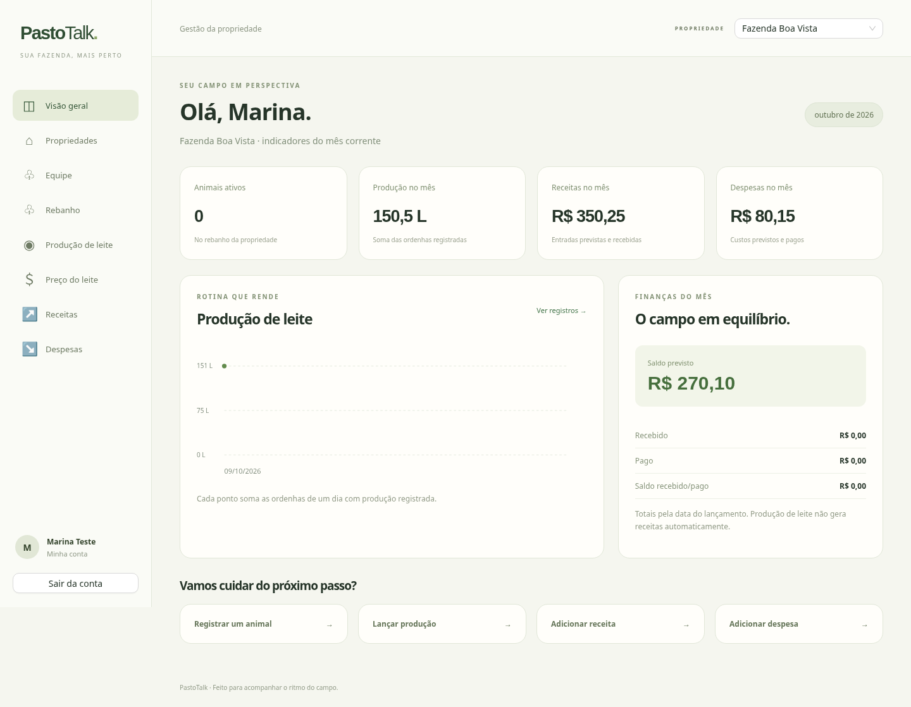

# PastoTalk

Gestão rural com React/TypeScript, Go e PostgreSQL. Esta é a reconstrução da entrega que ficou no ambiente anterior, baseada no repositório original e nos requisitos desta conversa. Foi novamente compilada e testada neste ambiente; não é uma cópia byte a byte do ZIP anterior.



[Equipe](docs/equipe-desktop.png) · [Equipe no celular](docs/equipe-mobile.png)

## Funcionalidades

- Cadastro de conta, login, restauração da sessão, saída e edição do perfil.
- Cadastro, edição e arquivamento de propriedades.
- Animais com identificação, sexo, nascimento, entrada, venda, óbito e URL de foto.
- Produção de leite, múltiplas ordenhas, histórico e gráfico mensal.
- Preço por litro: um preço por data e propriedade.
- Receitas e despesas com valores decimais, datas, pagamentos/recebimentos e parcelas informativas.
- Busca, ordenação, paginação, validações e mensagens de erro.
- Painel mensal com animais ativos, leite e finanças.
- Equipe por propriedade com permissões verificadas na API.
- Interface para desktop e celular.

## Iniciar com Docker

Requisitos: Docker e Compose v2.

```sh
cp .env.example .env
```

Edite .env: escolha uma senha forte para DB_PASSWORD e uma chave aleatória de pelo menos 32 caracteres para JWT_SECRET. Para gerar uma chave:

```sh
openssl rand -hex 32
docker compose up --build -d
```

Abra **http://localhost:3000**, crie sua conta e cadastre uma propriedade. A API fica em http://localhost:5000. O frontend encaminha /api para a API. O banco não é publicado na rede na configuração normal.

```sh
docker compose ps
docker compose logs -f api
docker compose down
```

O comando down mantém o volume do PostgreSQL. Não use down -v para desligar normalmente: isso apaga os dados do volume.

## Desenvolvimento local

Requisitos: Go 1.23 ou superior, Node.js 22 ou superior e PostgreSQL 16 ou superior.

Para usar somente o banco do Compose, após configurar .env:

```sh
docker compose -f docker-compose.yml -f docker-compose.dev.yml up -d db
```

Para um PostgreSQL instalado separadamente, crie o banco e aplique o esquema somente em um banco novo:

```sh
psql "$DATABASE_URL" -v ON_ERROR_STOP=1 -f api/sql/start.sql
```

API, em um terminal:

```sh
cd api/src
cp .env.example .env
# Ajuste conexão, senha e JWT_SECRET.
go mod download
go run .
```

Frontend, em outro:

```sh
cd webapp
npm ci
npm run dev
```

Abra http://localhost:3000. O proxy do Vite aponta para localhost:5000. DATABASE_URL substitui os campos DB_*; CORS_ORIGINS aceita origens separadas por vírgula. VITE_API_URL pode apontar para uma API externa.

## Equipe e compartilhamento

Na tela **Equipe**, selecione a propriedade e clique em **Adicionar membro**. Informe o nome de usuário de uma conta já cadastrada e escolha o papel. O acesso é concedido imediatamente, sem envio de convite por e-mail.

| Ação | Administrador | Colaborador | Somente leitura |
| --- | --- | --- | --- |
| Consultar painel, registros e equipe | Sim | Sim | Sim |
| Criar, editar e excluir animais e lançamentos | Sim | Sim | Não |
| Editar ou arquivar a propriedade | Sim | Não | Não |
| Adicionar/remover membros e alterar papéis | Sim | Não | Não |

- O criador da propriedade é seu primeiro administrador.
- Pode haver vários administradores. Cada pessoa pode ter papéis diferentes em propriedades diferentes.
- O último administrador ativo não pode ser removido ou rebaixado. Promova outro membro primeiro.
- Havendo outro administrador ativo, um administrador pode remover seu próprio vínculo ou reduzir seu próprio papel.
- Remover alguém revoga seu vínculo e preserva a conta e os registros.
- Papéis ficam no banco, não no token. A API verifica as permissões a cada requisição.
- Alterações de equipe e lançamentos usam a mesma trava por propriedade, protegendo a revogação e a regra do último administrador durante requisições simultâneas.
- A interface atualiza permissões ao recarregar ou retornar à janela do aplicativo.

## Atualizar um banco existente

**Faça backup primeiro.** Não substitua um banco existente pelo esquema de inicialização.

Para o banco do projeto original de 2024, aplique as duas migrações em ordem:

```sh
psql "$DATABASE_URL" -v ON_ERROR_STOP=1 -f api/sql/migrations/001_complete.sql
psql "$DATABASE_URL" -v ON_ERROR_STOP=1 -f api/sql/migrations/002_members.sql
```

A primeira migração adiciona nome e URL de foto aos animais, preserva a primeira foto da galeria antiga, renomeia date_sale para sale_date, converte valores em decimais e permite preços de leite na mesma data para propriedades diferentes.

Revise identificações vazias, gênero (female/male), datas e valores antigos antes de editá-los. Esta versão normaliza nomes de usuário para minúsculas; revise usuários antigos com maiúsculas e eventuais duplicidades antes de atualizar. As migrações não excluem registros.

Se o banco já usava a primeira entrega completa, aplique somente 002_members.sql. No Docker:

```sh
docker compose exec -T db psql -U pastotalk -d controledegado -v ON_ERROR_STOP=1 < api/sql/migrations/002_members.sql
docker compose up --build -d
```

A migração 002 transforma todos os vínculos antigos em administradores para preservar seus direitos. Revise os papéis na tela Equipe. Vínculos inseridos sem papel no banco usam viewer; novas propriedades criadas pela API atribuem admin explicitamente ao criador.

As migrações são manuais: reconstruir imagens não atualiza um volume existente. Faça login novamente na nova interface; os tokens anteriores foram substituídos.

## API

JSON, datas AAAA-MM-DD e autenticação Authorization: Bearer TOKEN. Erros retornam um objeto com o campo erro.

| Método | Rota | Uso |
| --- | --- | --- |
| GET | /health | Estado da API e do banco |
| POST | /users | Criar conta: name, email, username, password |
| POST | /login | Entrar: username, password |
| GET / PUT | /me | Consultar / atualizar o próprio perfil |
| GET | /dashboard?locationID=1 | Painel da propriedade; sem filtro, todos os vínculos |
| GET / POST | /locations | Listar / criar propriedades |
| GET / PUT / DELETE | /locations/{id} | Consultar / editar / arquivar |
| GET / POST | /locations/{id}/members | Listar / adicionar: username, role |
| PUT / DELETE | /locations/{id}/members/{userId} | Alterar role / remover vínculo |
| GET / POST | /locations/{id}/{resource} | Listar / criar registros |
| GET / PUT / DELETE | /locations/{id}/{resource}/{recordId} | Consultar / editar / excluir |

resource: animals, milk-productions, milk-prices, incomes, expenses.
role: admin, editor, viewer.
Membros retornam somente id, name, username e role. Propriedades incluem o papel do usuário autenticado. Contas não retornam hashes de senha. Os campos estão em api/src/models/records.go e webapp/src/modules/records/config.ts.

Sem permissão: 403. Propriedade sem vínculo ou arquivada: 404. Duplicidade ou tentativa de remover/rebaixar o último administrador: 409.

## Regras e limites

- Arquivamento preserva registros; não há tela de restauração.
- O painel usa o mês corrente do PostgreSQL. O Compose usa America/Porto_Velho.
- Saldo previsto = receitas menos despesas. Saldo recebido/pago usa somente lançamentos marcados como recebidos/pagos, pela data do lançamento.
- Parcelas são informativas; não há criação automática de contas a pagar.
- Produção e preço de leite não geram receitas automaticamente.
- Foto é uma URL externa; upload e galeria não estão implementados.
- Recuperação de senha por e-mail, convites pendentes, exportação de relatórios e publicação em um provedor não fazem parte desta entrega.
- Não houve envio automático ao GitHub. Para publicar, configure domínio, HTTPS, credenciais, backups e origens permitidas.

## Testes

```sh
cd api/src
go test -race ./...
go vet ./...
cd ../../webapp
npm ci
npm run lint
npm run build
```

Com banco e API exclusivos para testes:

```sh
python3 tests/integration.py
```

Esse teste cria contas e dados. Não rode contra produção. Cobre os cinco módulos, autenticação, isolamento, permissões, revogação, arquivamento, totais, validação, preços e proteção do último administrador durante requisições simultâneas.

Com frontend, API e banco de testes rodando:

```sh
cd webapp
npx playwright install chromium
npm run test:e2e
```

PASTOTALK_TEST_URL e PASTOTALK_WEB_URL permitem escolher outras URLs. Os testes cobrem cadastro, propriedade, lançamentos, edição, sessão, saída, login inválido e gestão de equipe em desktop e celular.

Para validar as migrações com o banco de um projeto Compose exclusivo para testes:

```sh
PASTOTALK_COMPOSE_PROJECT=pastotalk_recovery python3 tests/migrations.py
```

O .env precisa estar configurado para o Compose. O teste cria um banco com nome exclusivo e dados fictícios. A integração contínua verifica lint, build, testes Go e integração HTTP.

## Recuperação da entrega

A entrega inclui código, lockfile, SQL, Docker, testes e este README. As verificações reais estão em VALIDACAO.md.

Além do ZIP, foi gerado um Git bundle com o código e o histórico local:

```sh
git clone PastoTalk-recuperado.bundle PastoTalk
```

Restaurar-PastoTalk.py é uma alternativa em texto que contém a mesma versão do ZIP. Com Python 3, verifica a integridade e extrai em uma pasta nova. Recusa sobrescrever uma pasta com conteúdo:

```sh
python3 Restaurar-PastoTalk.py
```

Guarde pelo menos uma dessas cópias no seu computador. Arquivos locais de um ambiente temporário podem desaparecer quando ele é substituído.
